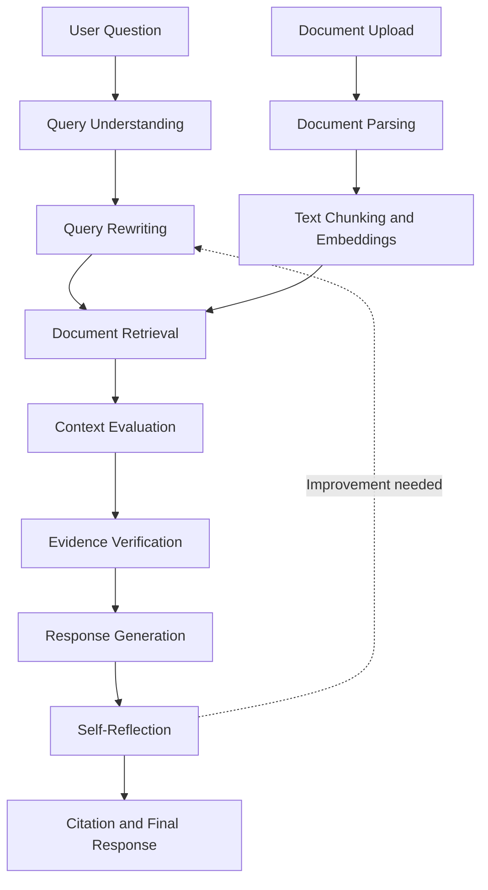

# Self-Correcting RAG System — Veritas AI

An intelligent Retrieval-Augmented Generation (RAG) platform designed to improve answer reliability through query understanding, document retrieval, context evaluation, evidence verification, citation handling, and iterative self-reflection.

**GitHub Repository:** [Self-Correcting-Rag-System](https://github.com/aarshiyasultana10-max/Self-Correcting-Rag-System)

## Overview

Traditional RAG systems retrieve relevant information and use it to generate answers, but retrieved context may be incomplete, irrelevant, or insufficient to support a response.

**Veritas AI** addresses this challenge with a modular, agent-based RAG pipeline that evaluates retrieved context, verifies evidence, and reflects on generated responses to support more reliable, context-aware answers.

The platform includes a web interface for document management and conversational interaction, backed by a Python API and dedicated data services.

## Key Features

- **Document Ingestion:** Upload and process supported documents for retrieval.
- **Intelligent Query Understanding:** Analyze user questions before retrieval.
- **Query Rewriting:** Refine queries to improve retrieval relevance.
- **Context Evaluation:** Assess whether retrieved information is sufficient to answer a question.
- **Evidence Verification:** Check whether generated answers are supported by available evidence.
- **Self-Reflection:** Evaluate responses and identify opportunities for improvement.
- **Citation Support:** Associate answers with relevant source evidence.
- **Vector Search:** Use Qdrant for vector-based document retrieval.
- **Interactive Chat Interface:** Ask questions and inspect supporting evidence.
- **User Authentication:** Provide registration, login, and protected application functionality.
- **Evaluation Support:** Maintain a RAG evaluation report for analyzing system behavior.

## System Architecture

The application follows a modular architecture with a React frontend, a FastAPI backend, and supporting data services.



*The diagram illustrates the intended logical workflow. The exact correction loop depends on the implemented pipeline and its runtime configuration.*

## Technology Stack

| Component | Technologies |
|---|---|
| Frontend | React, TypeScript, Vite |
| Styling | Tailwind CSS |
| Backend | Python, FastAPI |
| API Communication | REST APIs, Axios |
| LLM Integration | Google Gemini API or Ollama |
| Retrieval | Retrieval-Augmented Generation, Qdrant |
| Database | PostgreSQL |
| Caching | Redis |
| Authentication | JWT-based authentication |
| Document Processing | PDF, DOCX, Markdown and text parsers |
| Embeddings | Configurable embedding service |
| Database Migrations | Alembic |
| Observability | Optional LangSmith integration |
| Infrastructure | Docker Compose |

## Project Structure

```text
Self-Correcting-Rag-System/
├── backend/
│   ├── app/
│   │   ├── api/
│   │   ├── config/
│   │   ├── core/
│   │   ├── database/
│   │   ├── models/
│   │   ├── prompts/
│   │   ├── schemas/
│   │   └── services/
│   │       ├── agents/
│   │       ├── chunking/
│   │       ├── embeddings/
│   │       ├── parsers/
│   │       ├── pipeline/
│   │       └── preprocessing/
│   ├── alembic/
│   ├── requirements.txt
│   └── RAG_EVALUATION_REPORT.md
├── frontend/
│   ├── src/
│   │   ├── components/
│   │   ├── context/
│   │   ├── pages/
│   │   └── services/
│   ├── package.json
│   └── vite.config.ts
├── docker-compose.yml
├── .env.example
├── .gitignore
└── README.md
```

## Prerequisites

Install the following before running the application:

- Python 3.11 or a compatible version supported by the dependencies.
- Node.js and npm.
- Git.
- Docker Desktop with Docker Compose.
- A Google Gemini API key if using Gemini as the LLM provider, or a configured Ollama installation for local inference.

## Getting Started

### 1. Clone the Repository

```bash
git clone https://github.com/aarshiyasultana10-max/Self-Correcting-Rag-System.git
cd Self-Correcting-Rag-System
```

### 2. Configure Environment Variables

Create a `.env` file in the project root using `.env.example` as the template.

```bash
cp .env.example .env
```

On Windows Command Prompt, use:

```cmd
copy .env.example .env
```

Update the configuration with your own credentials and service settings. Set `GEMINI_API_KEY` if using Gemini, and configure a strong, unique `JWT_SECRET`.

Never commit real API keys, passwords, or production secrets.

### 3. Start Supporting Services

Ensure Docker Desktop is running, then execute:

```bash
docker compose up -d
```

This starts the configured PostgreSQL, Redis, and Qdrant services.

Check their status:

```bash
docker compose ps
```

### 4. Set Up the Backend

From the project root:

```bash
cd backend
python -m venv .venv
```

Activate the virtual environment on Windows:

```cmd
.venv\Scripts\activate
```

Install dependencies:

```bash
python -m pip install -r requirements.txt
```

Return to the project root configuration when setting environment variables, and ensure the backend process can read the required `.env` file.

Run the database migrations if required by the application's setup:

```bash
alembic upgrade head
```

Start the API server:

```bash
uvicorn app.main:app --reload
```

The API is typically available at:

- API base: `http://127.0.0.1:8000`
- Swagger documentation: `http://127.0.0.1:8000/docs`
- ReDoc documentation: `http://127.0.0.1:8000/redoc`

### 5. Set Up the Frontend

Open another terminal:

```bash
cd frontend
npm install
npm run dev
```

Open the local URL printed by Vite, commonly `http://localhost:5173`.

Ensure the frontend API configuration points to the running backend.

> These are development setup instructions. Actual startup requirements may vary depending on environment configuration, database migrations, and the installed dependencies.

## How the Self-Correcting RAG Workflow Works

1. **Query understanding:** Interpret the user's question and identify its information needs.
2. **Query rewriting:** Improve the search query when necessary.
3. **Retrieval:** Search the indexed document collection for relevant content.
4. **Context evaluation:** Determine whether the retrieved passages provide sufficient information.
5. **Evidence verification:** Evaluate whether the available evidence supports the proposed answer.
6. **Response generation:** Produce a response using the retrieved context.
7. **Self-reflection:** Assess the response for weaknesses and identify possible corrections.
8. **Citation handling:** Present relevant source references to help users inspect the evidence.

The goal is to reduce unsupported answers and improve the usefulness of retrieved information. Actual quality improvements should be established through evaluation rather than assumed.

## Evaluation

The repository includes `backend/RAG_EVALUATION_REPORT.md`, which can be consulted for the project's documented evaluation results.

Useful metrics for evaluating a RAG system include:

- **Retrieval Recall@K:** Whether relevant documents appear in the top K results.
- **MRR / nDCG:** The ranking quality of retrieved evidence.
- **Faithfulness:** Whether the response is supported by the retrieved context.
- **Answer Relevance:** Whether the answer addresses the user's question.
- **Citation Accuracy:** Whether citations correctly support the associated claims.
- **Latency:** The time required to retrieve evidence and generate an answer.

Use the evaluation report's actual results when presenting measured performance. Do not report unverified scores or claim that the system outperforms a baseline without supporting experiments.

## Security Considerations

- Keep API keys and database credentials out of source control.
- Use a strong JWT signing secret.
- Configure appropriate authentication and authorization.
- Validate uploaded files and user input.
- Avoid exposing sensitive document contents in application logs.
- Use secure production settings instead of development defaults.

## Future Improvements

- Add automated retrieval and generation evaluation.
- Implement bounded retry and correction policies.
- Add confidence-based fallback responses when evidence is insufficient.
- Improve citation-level evidence verification.
- Introduce automated regression tests for RAG quality.
- Add monitoring for latency, retrieval failures, and unsupported answers.
- Deploy the application using a production-ready container and hosting configuration.

## Learning Outcomes

This project brings together concepts from:

- Retrieval-Augmented Generation (RAG)
- Large Language Model (LLM) integration
- Agent-based AI workflows
- Semantic search and embeddings
- REST API development
- Full-stack web application development
- Database design and migrations
- Containerized infrastructure
- AI evaluation and reliability

## License

Refer to the repository's `LICENSE` file for applicable licensing terms.

---

**Project:** Self-Correcting RAG System — Veritas AI  
**Focus:** AI Engineering · RAG · LLM Applications · Full-Stack Development
